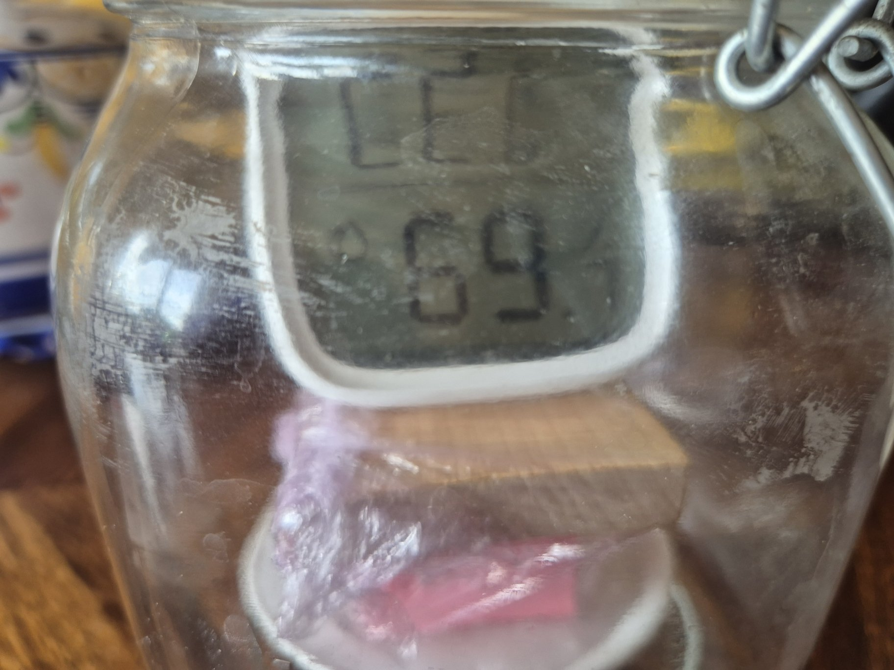
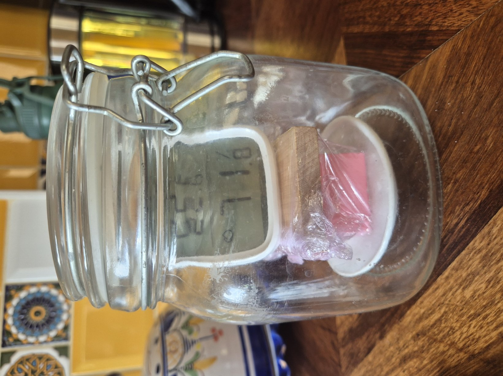

# Sonoff Salt Check — Test Record

This file records the saturated-salt test of the Sonoff SNZB-02D and the resulting DHT22 calibration decision.

---

## Summary

**T1 result (provisional until the slurry is checked on opening):** after ~20 h sealed, the Sonoff read **74.8 %** against a **75.4 %** reference at 21.0 °C. Error **−0.6 ± 1.9 points**. The hypothesis (within ±3) is supported, and the error can't be told apart from zero. **Keep the current DHT22 correction.**

T1 places the Sonoff in a sealed enclosure over saturated NaCl overnight. It compares the settled reading with the ~75.4 % reference and uses the error to keep or adjust the DHT22 correction.

---

## Test Record

### T1 — Sonoff vs Saturated NaCl, Overnight

**Date:** 2026-10-11 13:21 BST (sealed) → [TBC — opening time]

**Goal:**
Measure the Sonoff's humidity error at ~75 % RH against a saturated-salt reference, and decide whether the DHT22 correction (`true RH ≈ 0.483 × DHT22 + 26.36`) needs adjusting.

**Hypothesis:**
The Sonoff's settled reading is within ±3 points of the reference.

**Setup:**
- Enclosure, salt, and placement as in [setup.md](./setup.md).
- Sonoff SNZB-02D reporting via Zigbee2MQTT on the home Pi to BigQuery.
- Minimum duration: overnight, ideally **≥ 8 hours** sealed. Longer is better; do not open the container during the run.

**Measurements to Record:**
- Seal (start) and unseal (end) times, local time.
- Sonoff LCD humidity and temperature at start and just before opening. Photograph if possible.
- Room temperature at start and end, plus anything that changed overnight (heating on/off, window open, sun on container).
- Sonoff humidity and temperature reports from BigQuery for the whole run.
- Any reporting-threshold change made in Zigbee2MQTT.

**Pass Condition (hypothesis supported):**
The settled reading is within ±3.0 points of the temperature-adjusted reference.

**Validity Conditions (test is usable at all):**
- Undissolved salt still visible in the slurry at the end.
- Reading has **settled**: the time-weighted mean over the final 2 hours differs from the previous 2 hours by **≤ 0.5 points**, and is not still trending.
- Enclosure temperature range over the settled window is ≤ 1 °C.
- The Sonoff reported at least once during the final 2 hours, or the LCD reading was recorded at the end.

If a validity condition fails, record the run as a useful failure with its cause and repeat. Do not stretch the analysis to fit.

**Out of Scope:**
- Checking the Sonoff's slope or linearity. One reference point can only check the error at ~75 %. See [next-plan.md](./next-plan.md).
- Checking temperature accuracy.
- Putting the DHT22 itself in the enclosure.
- Re-fitting the DHT22 correction from new paired data.

**Decision to Make After Test:**
Keep the current DHT22 correction, or shift it using the decision rule below.

---

## Field Log

Record times in local time (BST until 2026-10-25). **BigQuery `datetime` values are UTC.** Subtract 1 hour from BST times when filtering queries. This was confirmed on 2026-10-09: the newest rows were stamped 19:32 when local time was ~20:34 BST.

| Event | Local time | UTC | Sonoff LCD RH | Sonoff LCD temp | Room temp | Notes |
|-------|------------|-----|---------------|-----------------|-----------|-------|
| Container sealed | 13:21 | 12:21 | 69.7 % (photo) | [TBC — not legible in photo] | ~22.4 °C (Sonoff, BigQuery) | Glass clip-top jar. Sonoff on a wooden block over a saucer of salt slurry. Photographed on the kitchen counter, then moved to the desk, away from the window, immediately after sealing (~13:25 BST) |
| Check | 13:24 | 12:24 | 71 % (photo; decimal not legible) | | | |
| Check | ~14:22 onwards | ~13:22 onwards | 72.8 % "most of the day" (anecdotal) | | | |
| Check | ~19:30 | ~18:30 | 73.8 % | | 21.4 °C (Sonoff, BigQuery) | |
| Check | ~09:20 (2026-10-12) | ~08:20 | 74.8 % | | 21.0 °C (Sonoff, BigQuery) | Unchanged from the last BigQuery step at 23:45 BST |
| Just before opening | | | | | | |
| Container opened | | | | | | |

Observations (reference by event, e.g. "sealed: condensation on lid"):

- Sealed: photos taken at 13:21 and 13:24 BST.


*13:21 BST, immediately after sealing. The display reads 69.x %, matching the 69.7 % BigQuery report at 12:21:51 UTC.*


*13:24 BST. Full setup: Sonoff on a cling-film-wrapped wooden stand on the slurry saucer. The display reads 71.x %.*

- Pre-seal (12:46–13:21 BST): BigQuery shows readings swinging between 63.9 and 72.4 % while the setup was being prepared. These are not part of the test.
- BigQuery humidity reports after sealing (UTC): 71.6 (12:21:36), 69.7, 70.8, 71.8 (12:22:42), 72.8 (13:22:11), 73.8 (15:53:47). Every report from 15:53 to 20:51 UTC (12 reports over 5 h) is 73.8.
- The Sonoff sends repeat reports about every 15–50 minutes even when nothing has changed. Humidity steps between reports during the run are exactly 1.0 point.
- Enclosure temperature (Sonoff, BigQuery): 22.4 °C at seal, falling to 21.4 °C by 18:03 UTC, then rising to 22.4 °C (19:37) and 23.0 °C (20:37).
- The LCD and BigQuery agree at both photographed times.

- Overnight (BigQuery, UTC): 73.8 until 22:32, then **74.8 from 22:45:47** to the latest report at 07:41:51 (19 reports over ~9 h). Temperature fell from 23.4 °C (21:36) to 21.0 °C (05:29) and stayed at 21.0 °C after that.
- Time between 1-point steps after sealing: 71.8 → 72.8 in 1.0 h, → 73.8 in 2.5 h, → 74.8 in 6.9 h. No further step in the ~9.6 h since.
- LCD at ~09:20 BST on 2026-10-12: 74.8 %.

Interim interpretation (2026-10-11 ~22:00 BST, kept for the record; observations above, conclusion in **Result**):

- Most of the rise happened in the first 3.5 h. Since then the reading has stayed within the same 1-point reporting step, so BigQuery can't show whether it is still creeping up. The LCD (0.1 resolution) can.
- The wooden stand is wrapped in cling film, so it shouldn't absorb much moisture or slow settling much.
- The temperature range since 16:53 BST is 1.6 °C (21.4–23.0), outside the ≤ 1 °C validity limit. The evening rise of 1.6 °C in 1.5 h is the kind of change that can briefly lower the reading at the sensor. Check whether the overnight period is steadier.

---

## Analysis Method

### 1. Settling Profile

Hourly time-weighted mean of the Sonoff's reported humidity. Each report stays in force until the next report. Replace the two times with the run's **UTC** seal and open times.

```sql
WITH p AS (
  SELECT DATETIME '2026-10-09 21:00:00' AS start_dt,   -- seal time, UTC
         DATETIME '2026-10-10 07:00:00' AS end_dt      -- open time, UTC
),
r AS (
  SELECT s.datetime AS t0,
         LEAST(COALESCE(LEAD(s.datetime) OVER (ORDER BY s.datetime), p.end_dt), p.end_dt) AS t1,
         s.humidity, s.temperature
  FROM `<project>.<dataset>.<sonoff_table>` s, p   -- substitute the real table
  WHERE s.datetime >= p.start_dt AND s.datetime < p.end_dt
)
SELECT DATETIME_TRUNC(t0, HOUR) AS hour_utc,
       COUNT(*) AS reports,
       ROUND(SUM(humidity * DATETIME_DIFF(t1, t0, SECOND)) / NULLIF(SUM(DATETIME_DIFF(t1, t0, SECOND)), 0), 2) AS tw_rh,
       MIN(humidity) AS min_rh, MAX(humidity) AS max_rh,
       MIN(temperature) AS min_t, MAX(temperature) AS max_t
FROM r
GROUP BY hour_utc
ORDER BY hour_utc;
```

*A report that spans an hour boundary is credited to the hour it started in. That is fine for checking settling, but use step 2 for the final value.*

### 2. Settled Value

- **Settled window:** the final 2 hours before opening, provided step 1 shows the curve has flattened.
- **Settled reading (`S`):** time-weighted mean RH over the settled window. Also note the last reported value and the LCD reading. If the LCD and BigQuery disagree by more than the reporting step, prefer the LCD and record why.
- **Enclosure temperature (`T`):** mean Sonoff temperature over the settled window.
- **Reference (`R`):** interpolate from the Greenspan table in [setup.md](./setup.md#reference-saturated-nacl) at `T`. For 18–23 °C this is 75.4–75.5 %.
- **Error:** `e = S − R`.

### 3. Uncertainty Budget

Estimate each term from the run itself, and replace the provisional values with measured ones.

| Source | How estimated | Provisional (±, RH points) |
|--------|---------------|----------------------------|
| Reference value (Greenspan) | Published uncertainty | 0.15 |
| Reference temperature (`T` uncertain by ~1 °C) | Table slope ≈ 0.03 points/°C | 0.03 |
| Temperature gradient inside the enclosure | ~4.5 points per 1 °C; assume ≤ 0.2 °C gradient in a stable location | 0.9 |
| Incomplete settling | Difference between last two 2-hour means | [TBC — from data, target ≤ 0.5] |
| Reporting threshold / resolution | Half the observed reporting step (~1 point), or 0.05 if read from the LCD | 0.5 (BigQuery) / 0.05 (LCD) |
| Short-term noise | Std. dev. of reports in settled window | [TBC — from data] |

Combined standard uncertainty `u` = root-sum-square of the rows. Use **U = 2u** (≈95 %) for decisions. With the provisional values, U ≈ 2.1–2.5 points if read from BigQuery, ≈ 1.8–2.1 if read from the LCD.

The temperature-gradient term dominates. A stable location matters more than anything else in the setup.

### 4. Decision Rule

The DHT22 correction maps the DHT22 onto the Sonoff's scale. If the Sonoff has an error `e` at ~75 %, and that error is assumed to be a **constant offset** across 50–75 % (the range the correction was fitted over), then:

```text
true RH ≈ 0.483 × DHT22 + (26.36 − e)
```

The slope is unchanged. Only the intercept moves.

| Outcome | Interpretation | Action |
|---------|----------------|--------|
| \|e\| ≤ U | Sonoff error not distinguishable from zero | **Keep** current correction. Record `e ± U` as the Sonoff's verified accuracy at 75 %. |
| U < \|e\| ≤ 3 | Hypothesis supported, but a real offset is likely | Keep the correction for now. Note the offset-adjusted intercept as an option. Prioritise a second reference point before changing anything. |
| \|e\| > 3 | Hypothesis rejected | **Adjust** the intercept to `26.36 − e`. Flag that the slope is unverified until a second reference point is run. |

Worked example: if `S = 77.4` and `R = 75.4`, then `e = +2.0`. The Sonoff over-reads by 2 points at 75 %. An offset-adjusted correction would be `0.483 × DHT22 + 24.36`.

Caveat: a single point cannot tell an offset from a gain error. If the Sonoff's error grows with humidity, a constant-offset shift would over-correct at the low end of the fitted range (~50 %). The offset assumption is the main limitation of this test.

---

## Result

**Result:** Sonoff error at the NaCl point **e = −0.6 points** (reads slightly low), expanded uncertainty **U ≈ 1.9 points**. Provisional until validity check 1 (undissolved salt) is confirmed on opening.

| Quantity | Value |
|----------|-------|
| Seal → open (UTC) | 2026-10-11 12:21 → [TBC — opening time] |
| Settled window (UTC) | 2026-10-12 05:29 → 07:42 (final 2 h of reports before the LCD reading) |
| Enclosure temperature `T` | 21.0 °C (constant over the settled window) |
| Reference `R` | 75.43 % at 21.0 °C (Greenspan, interpolated) → 75.4 % |
| Settled reading `S` (BigQuery TW mean) | 74.8 % (every report in the window is 74.8; ±1-point reporting step) |
| Sonoff LCD at end | 74.8 % at ~09:20 BST, 2026-10-12 |
| Error `e = S − R` | 74.8 − 75.4 = **−0.6** |
| Expanded uncertainty `U` | **≈ 1.9** (budget below) |

Uncertainty budget used (LCD reading, ± RH points):

| Source | Value | Basis |
|--------|-------|-------|
| Reference value | 0.15 | Greenspan |
| Reference temperature | 0.03 | `T` ± 1 °C × 0.036/°C |
| Temperature gradient in jar | 0.9 | Planned allowance for ≤ 0.2 °C gradient. Not measured; temperature was flat at 21.0 °C, so this is probably conservative |
| Incomplete settling | 0.2 | Steps were slowing (1.0 → 2.5 → 6.9 h) and none came in the next 9.6 h. The LCD matches the 74.8 step, but a small remaining creep can't be ruled out |
| Display resolution | 0.05 | 0.1 % LCD digit |
| Short-term noise | 0.1 | Single LCD reading; no finer data available |
| **Combined u / expanded U = 2u** | **0.94 / 1.9** | |

Validity conditions:

| # | Condition | Status |
|---|-----------|--------|
| 1 | Undissolved salt visible at end | [TBC — check on opening] |
| 2 | Settled (≤ 0.5 change between final 2-h windows, no trend) | ✅ The 74.8 step held for 9.6 h and the LCD agrees, so the change is below the reporting step and consistent with the LCD |
| 3 | Temperature range ≤ 1 °C over the settled window | ✅ 21.0 °C throughout (21.0–21.2 °C since 02:30 UTC) |
| 4 | Report in final 2 h, or LCD recorded | ✅ Both |

**Observations:**

- The reading took ~10.4 h after sealing to reach its final 1-point step (74.8 at 23:45 BST), much longer than the 2–3 h the setup notes implied.
- The largest temperature swings (21.4 → 23.4 → 21.0 °C) happened in the evening and early night, before the settled window.

**Conclusion:**
At ~75 % RH the Sonoff reads 0.6 points low, which is well inside both the ±3-point hypothesis and the ±1.9-point measurement uncertainty. The Sonoff is a sound reference at the top of the DHT22 correction's range. Its error there is too small to justify changing the correction. This test can't say whether the Sonoff is equally accurate at ~50 % (gain error); that needs a second reference point.

**Issues to Carry Forward:**

- Settling took ~10 h in this jar with a thin slurry. Future salt checks should allow ≥ 18–24 h, or use a larger slurry surface.
- The gradient term (0.9) dominates the uncertainty and was assumed, not measured. A second temperature probe in the jar would narrow it.
- A single NaCl point can't separate offset from gain. See T2 in [next-plan.md](./next-plan.md).

**Decision Made After Test:**
**Keep** `true RH ≈ 0.483 × DHT22 + 26.36`. |e| = 0.6 ≤ U = 1.9, so the first row of the decision rule applies. For reference only, the offset-adjusted alternative would be `0.483 × DHT22 + 26.96`. It is not adopted because the shift is smaller than its uncertainty.
